<p align="center">
  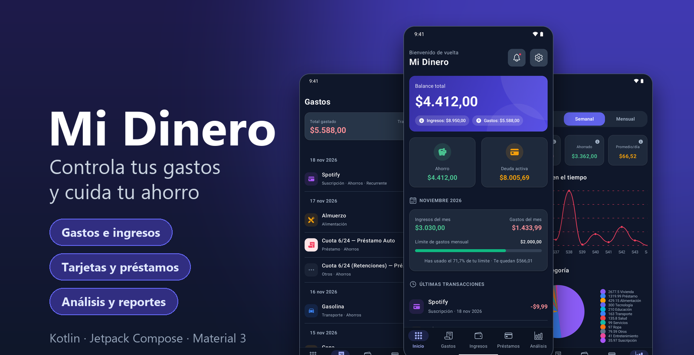
</p>

# Mi Dinero

**Mi Dinero** es una app Android para llevar tus finanzas personales sin cuentas ni servidores: registras gastos e
ingresos, controlas tarjetas de crédito y préstamos, ves en qué se te va el dinero y fijas un **límite de gastos
mensual** para ahorrar más. Funciona sin conexión (ni siquiera pide acceso a internet) y tus datos se quedan en el
teléfono, con backup manual en JSON.

Está hecha con Kotlin y Jetpack Compose (ver [Proyecto y stack](#proyecto-y-stack)). Las capturas de este documento
son de un emulador (Pixel 7a, Android 15) con datos de demostración ficticios.

## Qué puedes hacer

### Ver tu mes de un vistazo · *Inicio*

<div align="center">
<table>
  <tr>
    <td align="center">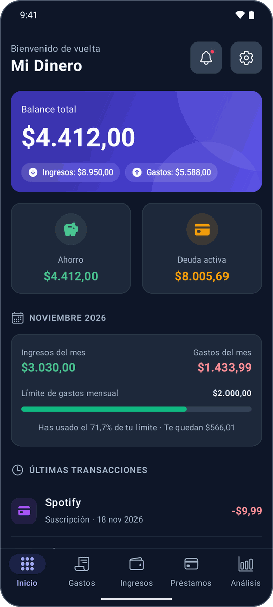<br><sub><b>Tu situación</b><br>balance, ahorro, deuda y límite</sub></td>
    <td align="center">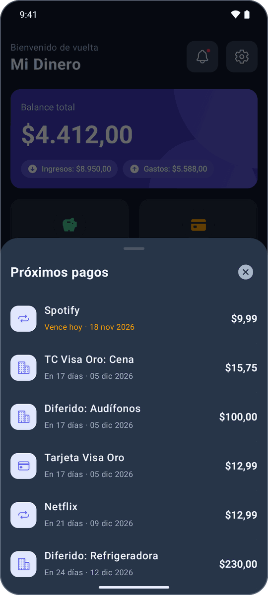<br><sub><b>Próximos pagos</b><br>los de los siguientes 30 días</sub></td>
    <td align="center">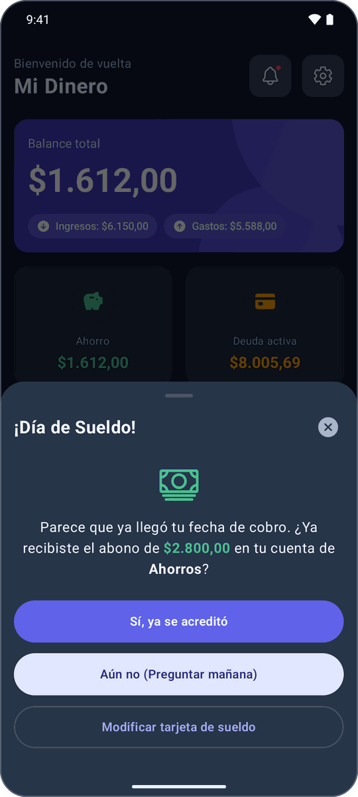<br><sub><b>¡Día de Sueldo!</b><br>confírmalo con un toque</sub></td>
  </tr>
</table>
</div>

- **Balance total, ahorro y deuda activa.** El balance suma los saldos iniciales de tus cuentas y los ingresos, y resta los
  gastos; el ahorro se pinta en rojo cuando es negativo.
- **Límite de gastos mensual.** La tarjeta del mes muestra cuánto del límite llevas usado (barra verde, ámbar al llegar al
  90 % y roja al superarlo) y cuánto te queda o cuánto te pasaste. Si todavía no lo defines, la propia tarjeta te invita a
  hacerlo.
- **Próximos pagos** (la campana): cuotas de préstamos, pagos de tarjetas y gastos recurrentes de los próximos 30 días; el
  punto rojo avisa cuando algo vence en 3 días o menos.
- **¡Día de Sueldo!** Al llegar tu fecha de cobro la app pregunta si ya se acreditó y lo registra como ingreso en tu cuenta
  (o te lo vuelve a preguntar mañana).
- Últimas transacciones con el ícono y el color de cada categoría; desliza hacia abajo para actualizar.

### Registrar y encontrar gastos · *Gastos*

<div align="center">
<table>
  <tr>
    <td align="center">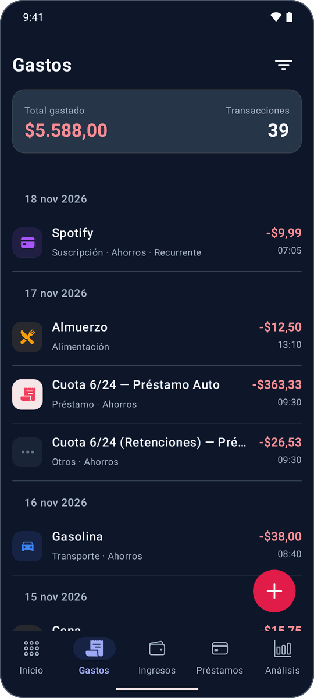<br><sub><b>Lista por día</b></sub></td>
    <td align="center">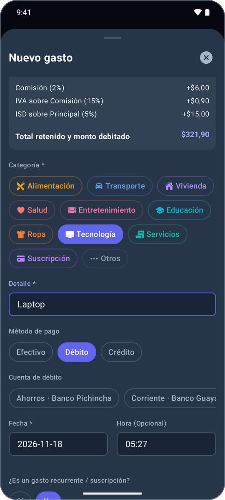<br><sub><b>Nuevo gasto</b><br>con desglose de impuestos</sub></td>
    <td align="center">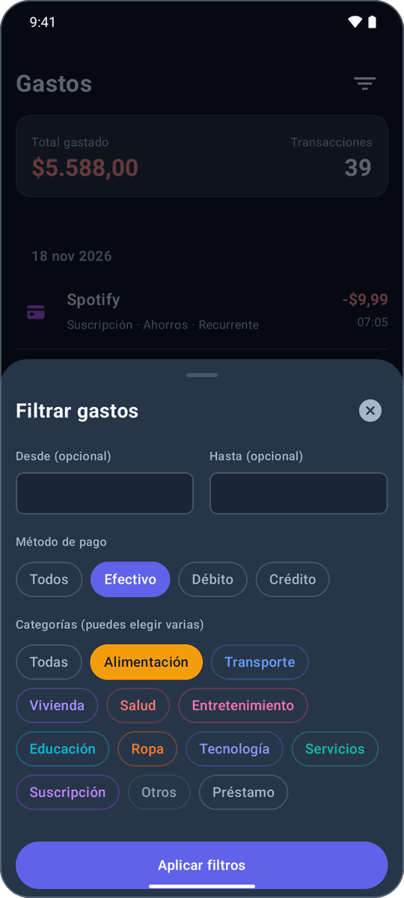<br><sub><b>Filtros</b></sub></td>
    <td align="center">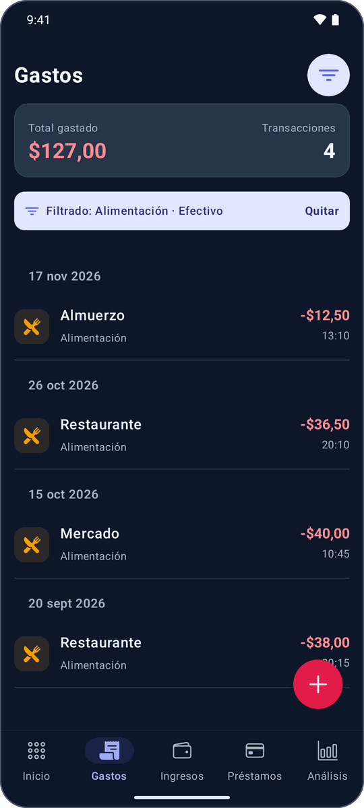<br><sub><b>Filtros activos</b><br>se quitan con un toque</sub></td>
  </tr>
</table>
</div>

- **Lista agrupada por día** con categoría, cuenta o tarjeta y marcas de *recurrente* o *diferido*; arriba, el total gastado
  y el número de transacciones.
- **Alta y edición** con monto, categoría (chips con su color e ícono), detalle, método de pago (efectivo, débito o
  crédito), cuenta o tarjeta, fecha y hora. Admite gastos **recurrentes** (mensual, un día concreto o anual) y compras
  **diferidas** a varios meses con tarjeta.
- **Motor de impuestos.** Si lo activas en Configuración, antes de guardar ves el desglose (comisión, IVA sobre la
  comisión e ISD) y el total que se va a debitar.
- Los errores aparecen junto a cada campo y la app valida el cupo de la tarjeta y el saldo de la cuenta.
- **Filtros** por rango de fechas, varias categorías y método de pago; una franja bajo el resumen muestra qué filtros están
  activos y los quita con un toque. Tocar un gasto abre su detalle para editarlo o eliminarlo.

### Cuentas, tarjetas e inversiones · *Ingresos*

<div align="center">
<table>
  <tr>
    <td align="center">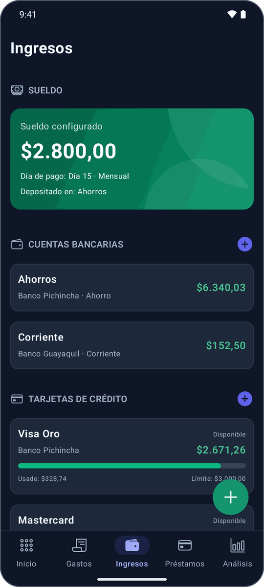<br><sub><b>Sueldo, cuentas y tarjetas</b></sub></td>
    <td align="center">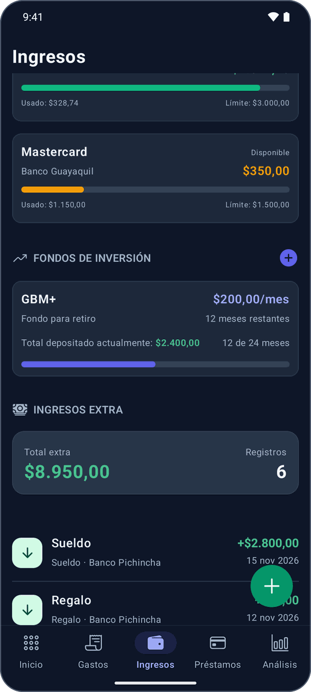<br><sub><b>Inversiones e ingresos extra</b></sub></td>
  </tr>
</table>
</div>

- **Sueldo** configurado: monto, día de pago (o último día / último día hábil), recurrencia y cuenta donde se deposita.
- **Cuentas bancarias** (ahorro o corriente) con su saldo actual: saldo inicial más ingresos, menos gastos.
- **Tarjetas de crédito** con el cupo disponible: la barra pasa de verde a ámbar (menos del 30 %) y a rojo (menos del 10 %),
  y la tarjeta se resalta cuando casi no queda cupo.
- **Fondos de inversión** con depósito mensual, meses restantes y progreso; el depósito mensual se registra como gasto.
- **Ingresos extra** con su detalle y la cuenta de destino.

### Cuotas y compras a crédito · *Préstamos*

<div align="center">
<table>
  <tr>
    <td align="center">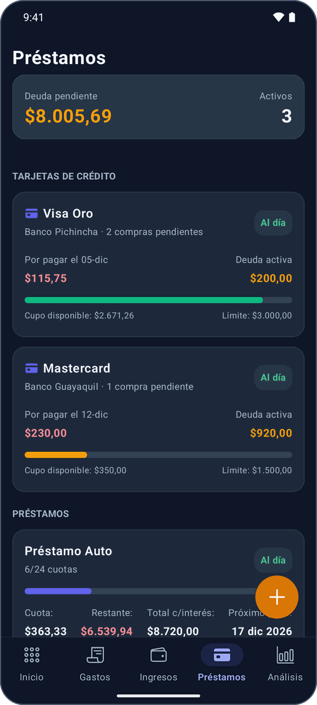<br><sub><b>Tarjetas y préstamos</b></sub></td>
    <td align="center">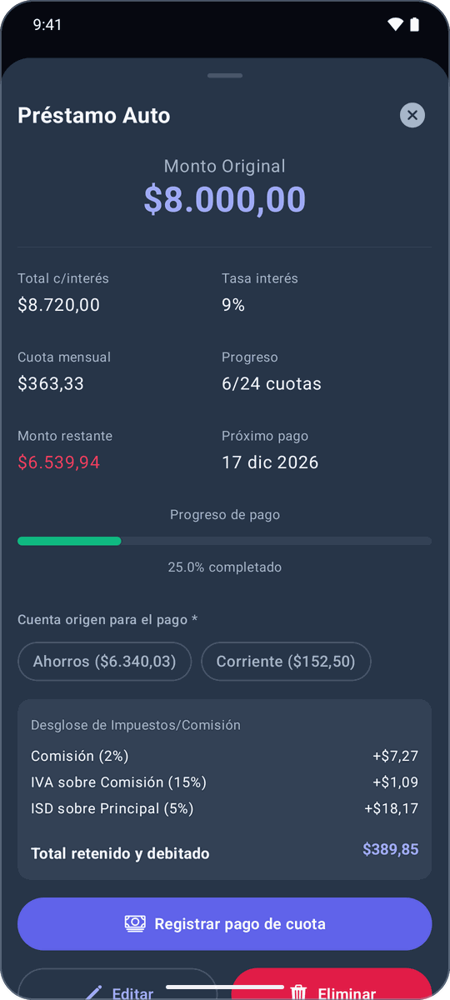<br><sub><b>Pagar una cuota</b></sub></td>
  </tr>
</table>
</div>

- Las compras con tarjeta se **agrupan por tarjeta**: cuánto toca pagar en la próxima fecha, la deuda activa, el cupo
  disponible y el estado (*Al día*, *Próximo a vencer* o *Vencido*).
- Cada préstamo muestra las cuotas pagadas, el monto restante, el total con interés y el próximo pago.
- **Registrar el pago de una cuota:** eliges la cuenta de origen y la app genera el gasto de la cuota (más las retenciones de
  impuestos, si están activas) y descuenta el saldo de la tarjeta.
- Una compra **diferida** con tarjeta crea sola su plan de cuotas.

### Entender tus gastos · *Análisis*

<div align="center">
<table>
  <tr>
    <td align="center">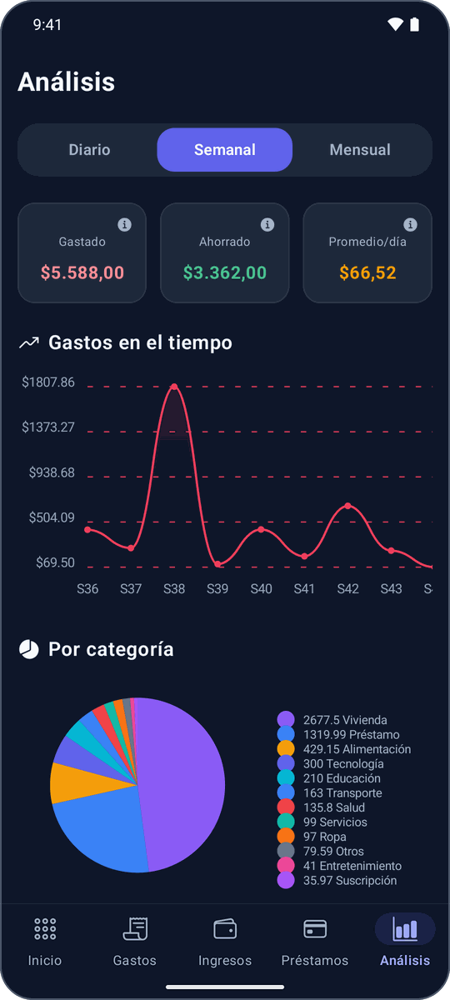<br><sub><b>Gastos en el tiempo</b></sub></td>
    <td align="center">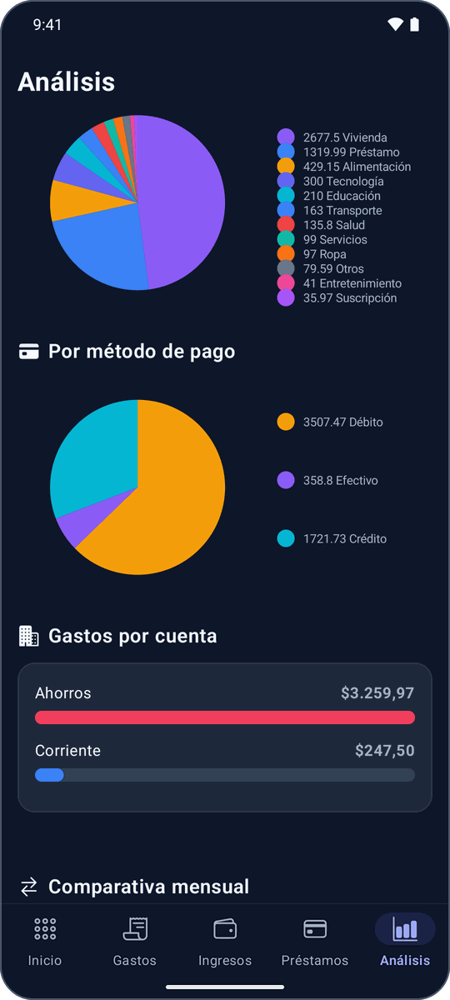<br><sub><b>Por categoría, pago y cuenta</b></sub></td>
    <td align="center">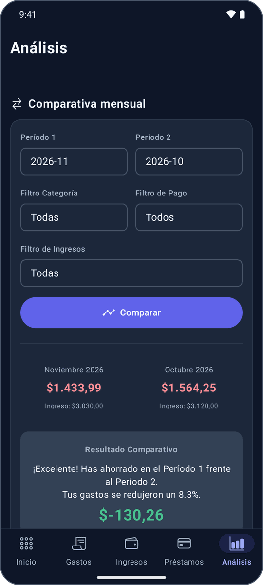<br><sub><b>Comparativa mensual</b></sub></td>
  </tr>
</table>
</div>

- Tarjetas **Gastado**, **Ahorrado** y **Promedio/día**, cada una con un ⓘ que explica cómo se calcula.
- Vista **diaria** (30 días), **semanal** (12 semanas) o **mensual** (12 meses).
- Gráficos de gastos en el tiempo (línea), por categoría y por método de pago (pastel) y por cuenta (barras).
- **Comparativa mensual:** eliges dos meses y, si quieres, filtras por categoría, método de pago o fuente de ingresos; la
  app te dice si ahorraste o gastaste más.

### Ajustarla a tu medida · *Configuración*

<div align="center">
<table>
  <tr>
    <td align="center">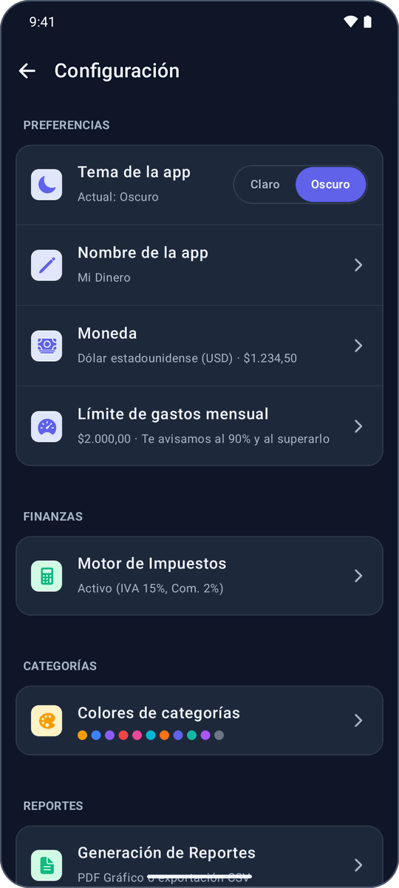<br><sub><b>Preferencias</b></sub></td>
    <td align="center">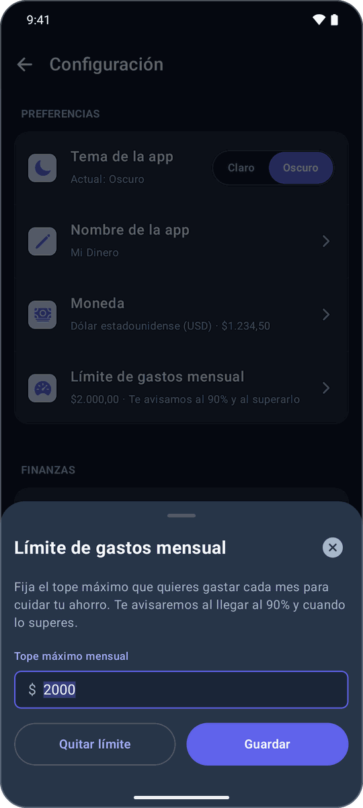<br><sub><b>Límite mensual</b></sub></td>
    <td align="center">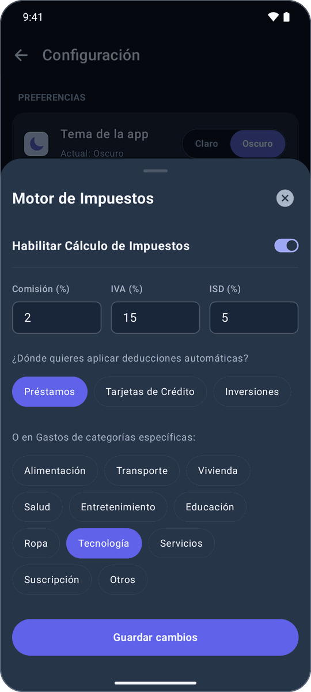<br><sub><b>Impuestos</b></sub></td>
    <td align="center">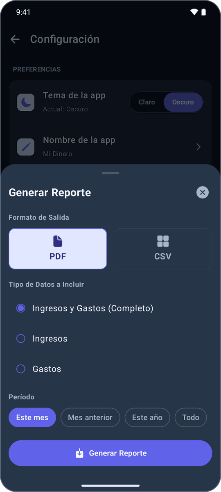<br><sub><b>Reportes</b></sub></td>
  </tr>
</table>
</div>

- Tema **claro u oscuro**, nombre de la app y **moneda** (18 opciones; en el primer inicio se propone la de la región del
  dispositivo).
- **Límite de gastos mensual:** el tope que no quieres superar; te avisa al llegar al 90 % y cuando lo superas.
- **Motor de impuestos:** comisión, IVA e ISD configurables y dónde aplicarlos (préstamos, tarjetas, inversiones o
  categorías de gasto concretas).
- **Colores de categorías** personalizables.
- **Reportes** en PDF con gráficos o en CSV, por tipo de datos (ingresos, gastos o todo) y por período, listos para
  compartir.
- **Backup** en JSON (exportar e importar) y borrado total de los datos con confirmación.

### Widget y avisos

<div align="center">
<table>
  <tr>
    <td align="center">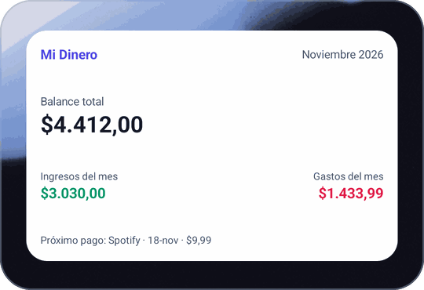<br><sub><b>Widget «Resumen financiero»</b> (4×2)</sub></td>
  </tr>
</table>
</div>

- **Widget** con el balance total, los ingresos y gastos del mes y el próximo pago, sin abrir la app.
- **Notificaciones locales:** recordatorios de pago (a las 09:00 del día anterior o del mismo día) y una alerta cuando el
  gasto del mes llega al 90 % de tu límite o lo supera.

### Tema claro

<div align="center">
<table>
  <tr>
    <td align="center">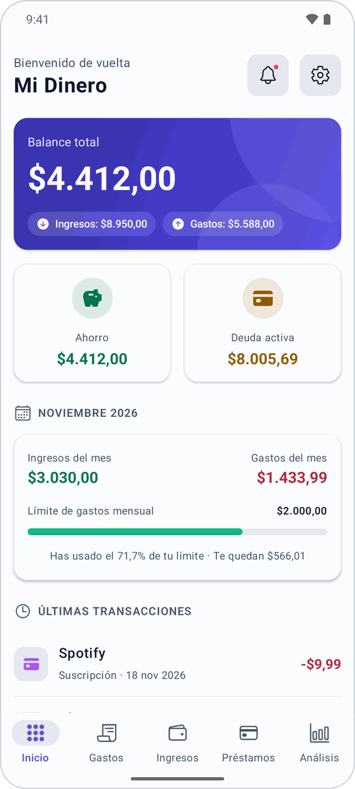<br><sub><b>Inicio</b></sub></td>
    <td align="center">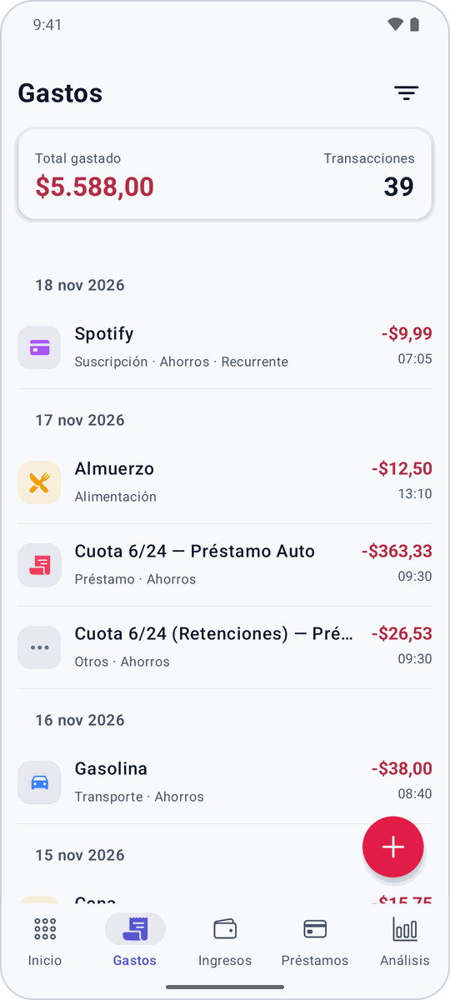<br><sub><b>Gastos</b></sub></td>
    <td align="center">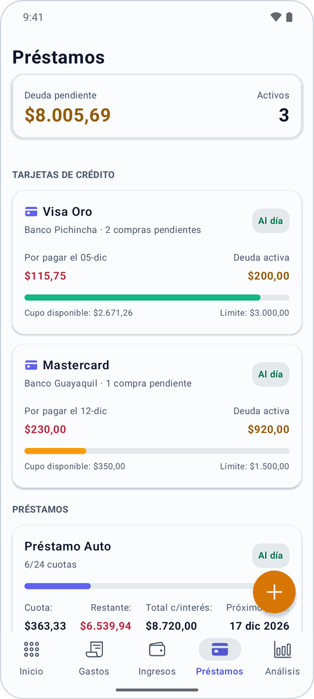<br><sub><b>Préstamos</b></sub></td>
    <td align="center">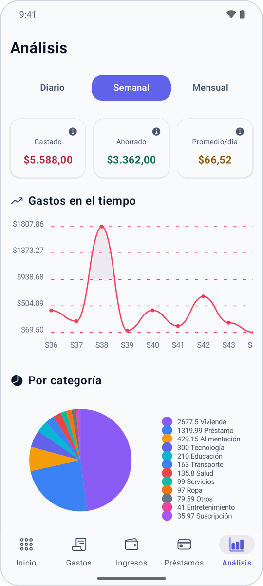<br><sub><b>Análisis</b></sub></td>
  </tr>
</table>
</div>

La paleta de los dos temas se comprueba con pruebas automáticas de contraste (WCAG AA); ver [Usabilidad](#usabilidad-heurísticas-de-nielsen).

## Proyecto y stack

Proyecto Android nativo que se abre y compila con Android Studio. Es el traslado 1:1 de la antigua app
Expo / React Native, que ya se eliminó del repositorio (sigue disponible en el historial de git, p. ej. en el
commit `2fb0d12` o en la rama `main`).

- Paquete: `com.mixagames666.trackerrntemp` (el mismo que la app React Native).
- `minSdk` 24 · `compileSdk`/`targetSdk` 35 · Kotlin 2.0.21 · AGP 8.6.1 · Gradle 8.8 · Compose BOM 2024.12.01.
- Sin Hilt ni Room: inyección manual (`AppContainer`) y datos en documentos JSON (ver [Datos](#datos)).

## Resumen de funciones

Todo lo que hace la app React Native, con los mismos textos en español, validaciones y mensajes:

| Área | Contenido |
|---|---|
| Navegación | 5 pestañas (Inicio, Gastos, Ingresos, Préstamos, Análisis) + Configuración apilada, tema claro/oscuro, splash animado, toasts, hojas inferiores arrastrables, pull-to-refresh, recarga al enfocar |
| Gastos | alta/edición/borrado, filtros (fechas, categorías, método), recurrentes (mensual / día / anual), diferidos, motor de impuestos, validaciones de cupo/saldo/balance, compras con tarjeta ↔ préstamo ↔ saldo de tarjeta |
| Ingresos | sueldo (con aviso «Día de sueldo»), cuentas, tarjetas de crédito, fondos de inversión (depósito mensual → gasto), ingresos extra |
| Préstamos | cuotas, pago de cuota (genera gasto y baja el saldo de la tarjeta), tarjetas agrupadas por ciclo de corte |
| Análisis | línea / pastel / barras, comparativa mensual con filtros |
| Configuración | tema, nombre, moneda (18 + detección por región), límite de gastos mensual, impuestos, colores de categorías, reportes PDF/CSV, backup JSON (exportar/importar), borrar todo |
| Plataforma | notificaciones locales (recordatorios de pago 09:00 + alerta de presupuesto 90 %/100 %), widget «Resumen financiero» 4×2 |

## Abrir y compilar

Requisitos: **Android Studio Koala (2024.1.2) o posterior**, JDK 17+ (el JBR que trae el IDE sirve) y el SDK de
Android 35 (platform + build-tools).

1. *File → Open* y elegir la raíz del repositorio.
2. Dejar que Gradle sincronice (Android Studio crea `local.properties` con `sdk.dir`; no se versiona).
3. *Run ▶* sobre un emulador o dispositivo (API 24 o superior).

Desde la terminal, en la raíz del repositorio:

```bash
./gradlew assembleDebug        # app/build/outputs/apk/debug/app-debug.apk
./gradlew testDebugUnitTest    # pruebas JVM (vectores dorados + utilidades)
./gradlew lintDebug
./gradlew assembleRelease      # APK sin firmar (ver "Publicar")
```

En Linux/macOS (o en CI) el wrapper necesita permiso de ejecución: `chmod +x gradlew` (si el proyecto se versionó
desde Windows, `git update-index --chmod=+x gradlew` lo deja guardado en el repositorio).

**Windows y rutas largas.** Si el repositorio está en una ruta larga y `LongPathsEnabled` está en 0, Gradle
falla al escribir en `build/`. Define `ANDROID_KOTLIN_BUILD_ROOT` con una carpeta corta (p. ej. `C:\tgb`) y el
`build.gradle.kts` raíz redirigirá allí todas las salidas (el APK queda en `C:\tgb\app\outputs\apk\debug`).
En otros sistemas no hace falta.

El build *debug* usa el sufijo `.debug` (`com.mixagames666.trackerrntemp.debug`) y la etiqueta
«tracker-rn-temp (Kotlin)», así convive con la app React Native instalada.

## Mapa React Native → Kotlin

Raíz del código: `app/src/main/java/com/mixagames666/trackerrntemp/`.

| React Native | Kotlin |
|---|---|
| `index.ts`, `App.tsx` | `MainActivity`, `TrackerApp` (Application), `AppContainer` (dependencias), `ui/AppRoot` (init de moneda/categorías/préstamos legacy, splash animado, sincronización al volver a primer plano) |
| `src/types/index.ts` | `data/Models.kt` (`@Serializable`, mismos campos opcionales que los JSON) |
| `src/db/storage.ts` | `data/JsonStore`, `data/Repositories`, `data/Aggregates`, `data/Backup`, `data/BackupFiles` |
| `utils/formatters.ts`, `currency.ts` | `util/Formatters`, `util/Currency`, `util/JsCompat` (semántica de JavaScript), `util/Time` |
| `utils/cardPurchases.ts`, `paymentReminders.ts`, `dataSync.ts` | `domain/CardPurchases`, `domain/PaymentReminders`, `domain/DataSync` |
| lógica dentro de las pantallas (guardar gasto, pagar cuota, análisis…) | `domain/Services` (gastos, préstamos, tarjetas, inversiones), `domain/Dashboard`, `domain/Analytics` |
| `utils/localNotifications.ts`, `hooks/useNotifications.ts` | `notifications/PaymentNotifications`, `notifications/ReminderWorker` |
| `utils/reportGenerator.ts` | `reports/ReportGenerator` (rango, CSV), `reports/PdfReport` (PDF), `reports/ShareFile` |
| `src/widgets/*` | `widget/SummaryWidget` (Jetpack Glance) + `res/xml/summary_widget_info.xml` |
| `theme/colors.ts`, `ThemeContext.tsx` | `ui/theme/Colors`, `Theme`, `ThemeController` |
| `components/*` | `ui/components/*` (`BottomSheet`, `Button`, `Card`, `Chip`, `ProgressBar`, `AppTextField`, `DatePickerSheet`, `CurrencyPicker`, `WelcomeSheet`, `ActionFeedback`) + `Ionicon`, `AlertHost` (≙ `Alert.alert`), `AutoSizeText` (≙ `adjustsFontSizeToFit`) |
| `navigation/*` | `ui/navigation/AppNavigation` |
| `screens/*Screen.tsx` | `ui/screens/<x>/<X>Screen` + `<X>ViewModel`; gráficos en `ui/charts` |

## Datos

- Cada colección es un archivo `files/stores/<nombre>.json` con un arreglo, igual que cada clave
  `@tracker_gastos_<nombre>` de AsyncStorage. Mismos nombres de campo, mismos ids y misma semántica
  (`add`, `update` con fusión, `getByDateRange`…). Las escrituras son atómicas (archivo temporal + rename) y cada
  colección tiene su propio candado.
- **El backup JSON es idéntico** al de la app React Native (`_exportDate` + una clave por colección): un backup
  exportado en una versión se importa en la otra.
- **Migración desde la app React Native.** Si esta versión se instala *sobre* la de React Native (mismo paquete y
  misma firma), `LegacyAsyncStorageImporter` copia una sola vez las colecciones de `databases/RKStorage`
  (la base SQLite de AsyncStorage) al primer arranque, antes de leer o escribir nada. Nunca pisa datos ya
  guardados por esta app. El receptor del widget se llama `Resumen` como en React Native, de modo que el
  widget ya colocado en la pantalla de inicio sigue funcionando.

## Cómo se comprobó la paridad

Los vectores dorados de `app/src/test/resources/golden/*.json` se generaron ejecutando la lógica **original**
en TypeScript (`formatters`, `cardPurchases`, `paymentReminders`, `storage`, `reportGenerator`, `currency`) con
*stubs* de AsyncStorage y de los módulos `expo-*`, reloj congelado (2026-11-17 12:00, `America/Guayaquil`) e ids
normalizados. Son 18 escenarios (compras a crédito diferidas, cambio de monto/tarjeta/método, impuestos, pago de
todas las cuotas, vinculación legacy, próximos pagos, agregados, dashboard y aviso de sueldo, análisis en
martes/domingo/enero, CSV y modelo del PDF, categorías y ajustes, round-trip del backup…). Los tests de Kotlin
(`golden/GoldenTest`) repiten cada escenario con el código portado y exigen el mismo resultado en cada paso y el
mismo estado final de las colecciones.

```bash
./gradlew testDebugUnitTest
```

> La herramienta que generaba los vectores (`tools/golden/`) dependía del código TypeScript y se eliminó junto con
> él; los `.json` ya generados se conservan y siguen siendo la referencia de las pruebas.

La semántica de JavaScript que el resto del código necesita (`toFixed`, `parseFloat`, `Math.round`, número→texto,
desborde de fechas) también se compara contra Node en el escenario `js-and-formatters`. Aparte hay pruebas del
almacén JSON y de los serializadores tolerantes (tipos distintos, archivo corrupto, altas concurrentes, registros
ilegibles que se conservan al guardar) y del importador de AsyncStorage.

## Decisiones y diferencias deliberadas

| Tema | Decisión |
|---|---|
| UI | Jetpack Compose + Material 3 con los tokens de `colors.ts` como tema propio (sin colores dinámicos). Tema oscuro por defecto, como el original. Dos ajustes mínimos por accesibilidad: `primary` oscurecido ~3 % (`#6366F1` → `#6063EA`, el texto blanco pasa de 4,47:1 a 4,70:1) y `onSurfaceVariant` aclarado en oscuro (`#94A3B8` → `#A3B3C7`, 4,1:1 → 4,85:1 sobre las superficies más claras). |
| Iconos | `Ionicons.ttf` y el glifo `piggy-bank` de MaterialCommunityIcons embebidos: los nombres guardados en las categorías (`restaurant`, `car`…) siguen funcionando. |
| Gráficos | Canvas propios que replican `react-native-chart-kit` (línea bezier con eje Y fijo, pastel con leyenda, barras). |
| PDF | `android.graphics.pdf.PdfDocument` dibuja el mismo contenido que el HTML de `reportGenerator.ts` (el modelo de datos del PDF se compara con el HTML original en las pruebas). |
| Notificaciones | Canal «Recordatorios y alertas» + WorkManager (un trabajo único por recordatorio, 09:00 del día anterior o del mismo día, máx. 50 en 60 días) + permiso `POST_NOTIFICATIONS` en Android 13+. |
| Widget | Jetpack Glance, mismo tamaño (4×2), textos y paleta clara/oscura; refresco cada 30 min y tras cada cambio de datos. |
| Formatos | `formatCurrency`/`formatDate*` usan `android.icu` (la misma base ICU que el `Intl` de Hermes), con 2 decimales y `es-EC` fijo para fechas. |
| Nombre | El launcher se llama `tracker-rn-temp` (`strings.xml → app_name`); el nombre que se ve dentro de la app («Mi Dinero») es un ajuste del usuario. |
| Versión | `versionCode = 1`, `versionName = "1.0.0"`: EAS gestionaba el código remotamente, súbelo por encima del último publicado antes de actualizar una instalación existente. |

## Usabilidad (heurísticas de Nielsen)

Convenciones que conviene mantener al tocar la interfaz:

| Heurística | Cómo se aplica |
|---|---|
| 1 · Visibilidad del estado | Toast al guardar (`ToastManager`), barra de *filtros activos* en Gastos y, en el Dashboard, porcentaje usado / restante / excedido del límite mensual. |
| 2 · Lenguaje del usuario | El objetivo es ahorrar: «Límite de gastos mensual» (el dato guardado sigue llamándose `monthlyGoal`). Los porcentajes usan el separador de la moneda activa (`formatPercentLocalized`). |
| 3 · Control y libertad | «Quitar límite», «Quitar filtros»; las hojas se cierran con el fondo, el gesto o Atrás. |
| 4 · Consistencia | Un solo nombre para el límite en Dashboard, Configuración y notificaciones; mismo ritmo vertical (16 dp) en todos los formularios (`FormColumn`). |
| 5 · Prevención de errores | Acciones destructivas en rojo en los avisos, campos numéricos saneados y unidad (moneda) dentro del campo (`prefix`). |
| 6 · Reconocer en vez de recordar | `supportingText` y `help` (ⓘ) en los campos; la tarjeta del Dashboard invita a fijar el límite si todavía no existe. |
| 7 · Eficiencia | Estados vacíos con la acción siguiente; al editar un campo con foco automático el texto queda seleccionado. |
| 8 · Diseño minimalista | `FormColumn` evita los espacios dobles entre campos (antes ~32 dp). |
| 9 · Errores claros | Error junto al campo (`FieldError`: ícono + texto); el formulario de gastos vuelve arriba para mostrarlos. |
| Accesibilidad | Objetivos táctiles de 48 dp, descripción en los botones «+», estado «seleccionado» en los chips; los íconos decorativos se ocultan al lector de pantalla (`Ionicon`) y la barra de progreso expone su valor. |
| Contraste (WCAG) | Todo texto ≥ 4,5:1 en los dos temas: `primaryText` / `successText` / `warningText` / `errorText` se calculan desde el color base con `readableOn` (mismo tono, ajustado a la superficie más exigente); los tonos base quedan para rellenos, barras e íconos. `ThemeContrastTest` lo comprueba sobre cada superficie. |
| Superficies y jerarquía | Tarjetas con borde de 1 dp (`cardBorder`: en oscuro la sombra no se ve), tarjetas destacadas con degradado (`primaryDeep` → `primaryDark`) y círculos translúcidos, estado activo de la barra de pestañas con píldora (no sólo color). |
| Cifras y movimiento | Montos con cifras tabulares (`MoneyStyle`: los dígitos de una lista quedan alineados); barras de progreso animadas en la fase de dibujo (700 ms; con las animaciones del sistema desactivadas saltan al valor final). |
| Estados vacíos | Un único `EmptyState` (ícono tintado, título, explicación y acción) en Inicio, Gastos, Ingresos y Préstamos. |

**Hojas inferiores.** `BottomSheet` ancla su ventana arriba y la extiende a toda la pantalla; la hoja llega al borde inferior y
reserva el espacio del teclado *dentro* de sí misma. Así no queda ningún hueco bajo la hoja aunque el IME reserve espacio sin
dibujar nada (teclado físico en el emulador, donde sólo ocupa la altura de la barra de navegación).

## Quirks del original que se conservan

Se portaron tal cual para no cambiar el comportamiento; quedan listados por si quieres corregir alguno más adelante.

- El atajo «Hace 1 mes» del selector de fecha (y los meses de Análisis) resta un mes con el desborde de `Date` de JavaScript: `setMonth(-1)` un día 31 cae el 3 del mes siguiente.
- La semana de Análisis empieza en domingo (`getDay()`).
- El período 2 de la comparativa de Análisis vale por defecto el mes anterior, pero en enero se queda en enero (`Math.max(1, mes)`) en vez de saltar a diciembre.
- El tema por defecto es oscuro aunque el sistema esté en claro; un ajuste `system` deja el tema claro hasta que cambie el esquema del sistema.
- `clearAllData` vacía todas las colecciones menos los ajustes, categorías incluidas, hasta el siguiente arranque (que vuelve a sembrarlas).
- `formatDate` y `formatDateShort` usan siempre `es-EC`, aunque se cambie la moneda/región.
- `update()` de un id inexistente lanza una excepción, como en `storage.ts`.

## Lo que no se porta

- Código muerto del original: `BarChart`/`barData`/`barIncomeAcc`/`chartConfig` de Análisis (se calculan pero nunca se dibujan), `spacing`/`radius`, `SalaryRepo.get/delete`, `ExpenseRepo.getByCategory`.
- Los apaños de `react-native-chart-kit` (`forceVariation`: con datos planos el original dibuja un punto de 1,00 en el último día; valor centinela `0.01` en las barras) — con gráficos propios no hacen falta.

## Publicar

No hay *keystore* en el repositorio. Para **actualizar** una instalación de la app React Native hay que firmar con la
misma clave (EAS la guarda: `eas credentials` permite descargarla):

1. Crea `keystore.properties` (fuera del control de versiones) y añade un `signingConfigs.release` en
   `app/build.gradle.kts`, o usa *Build → Generate Signed Bundle / APK* en Android Studio.
2. Sube `versionCode` por encima del último publicado.
3. `isMinifyEnabled` está en `false`; si lo activas, `app/proguard-rules.pro` ya conserva lo necesario y
   `kotlinx.serialization`, WorkManager y Glance publican sus propias reglas.

## Verificado y pendiente

Verificado en esta rama: compilación *debug* y *release* sin errores, 29 pruebas JVM en verde (18 escenarios
dorados + 11 de almacén e importador), `lintDebug` sin errores, y recorrido en un emulador Pixel 7a con Android 15 de: Inicio
(incl. aviso de sueldo), Gastos (alta, detalle, borrado), Ingresos, Préstamos (grupos de tarjeta, pago de cuota con
impuestos), Análisis, Configuración (tema, reportes PDF y CSV con el selector de compartir, exportar/importar
backup, borrar todo), notificaciones (canal, permiso, recordatorios programados, alerta de presupuesto), widget en el
launcher (render y toque que abre la app) y la migración desde una base `RKStorage` simulada.

No se pudo comprobar aquí:

- La apariencia pixel a pixel frente a la app React Native en un dispositivo real (no hay una compilación RN instalable en este entorno).
- La actualización sobre un APK firmado por EAS (requiere el *keystore*); la migración de datos se probó con una base SQLite del mismo esquema que AsyncStorage.
- Android 7–12 (sólo se probó API 35): en ellos no hay permiso de notificaciones en tiempo de ejecución y el widget usa el diseño por defecto de Glance.
- Pruebas instrumentadas de UI (no hay).
